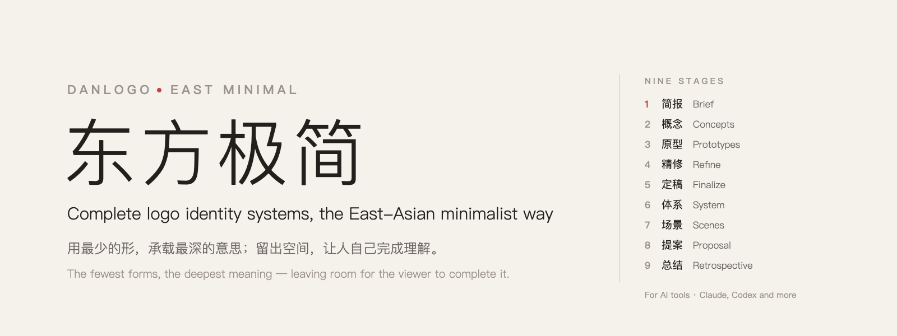
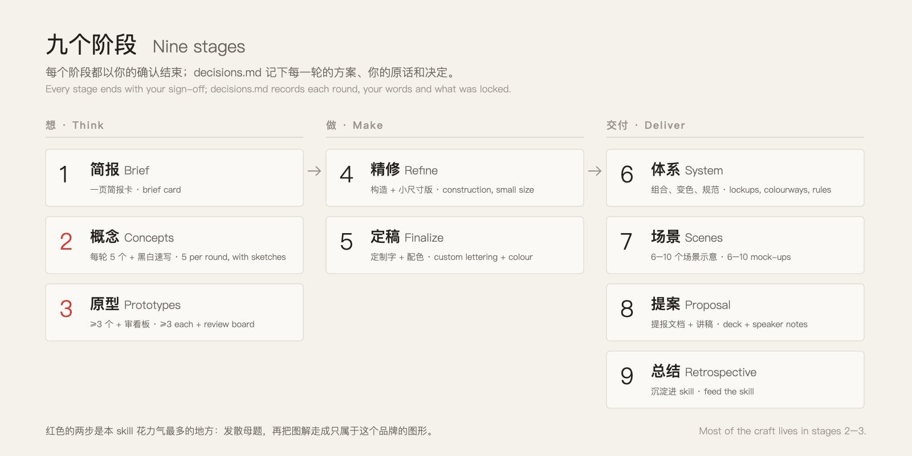
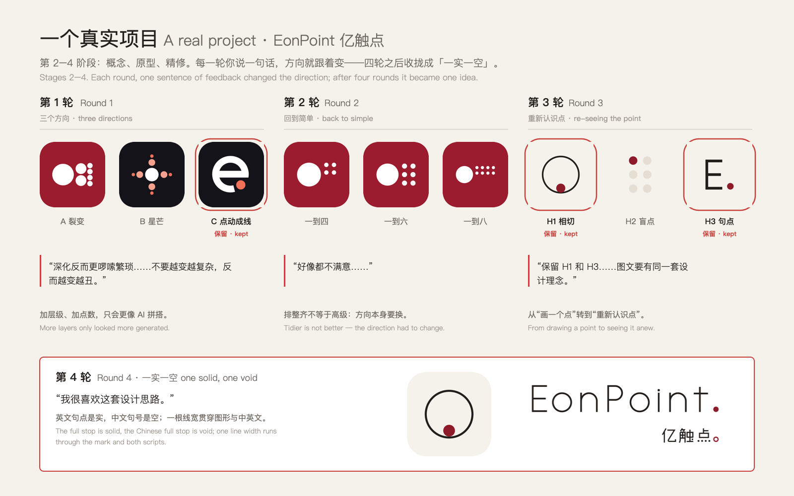
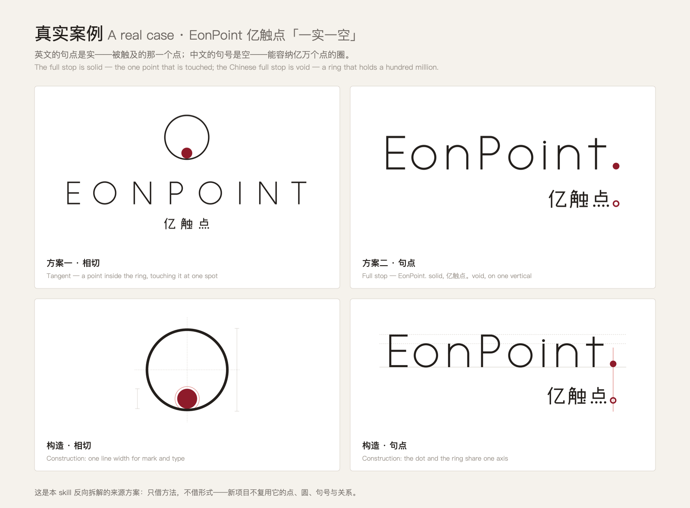
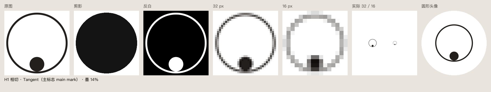
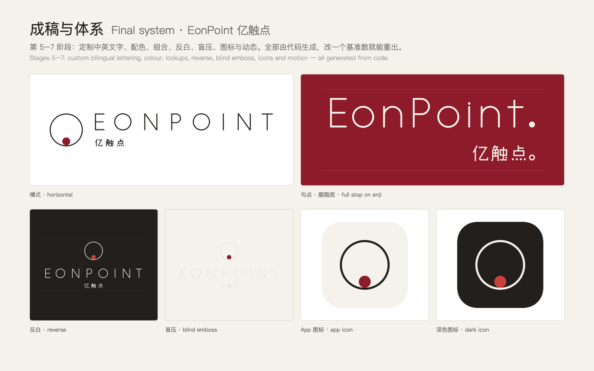
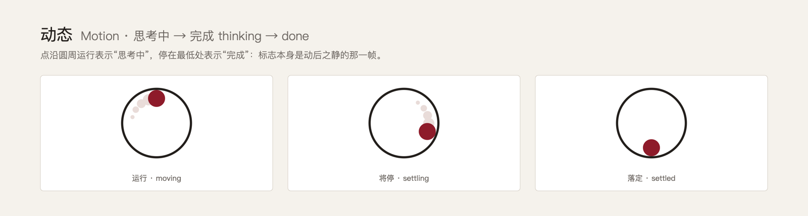
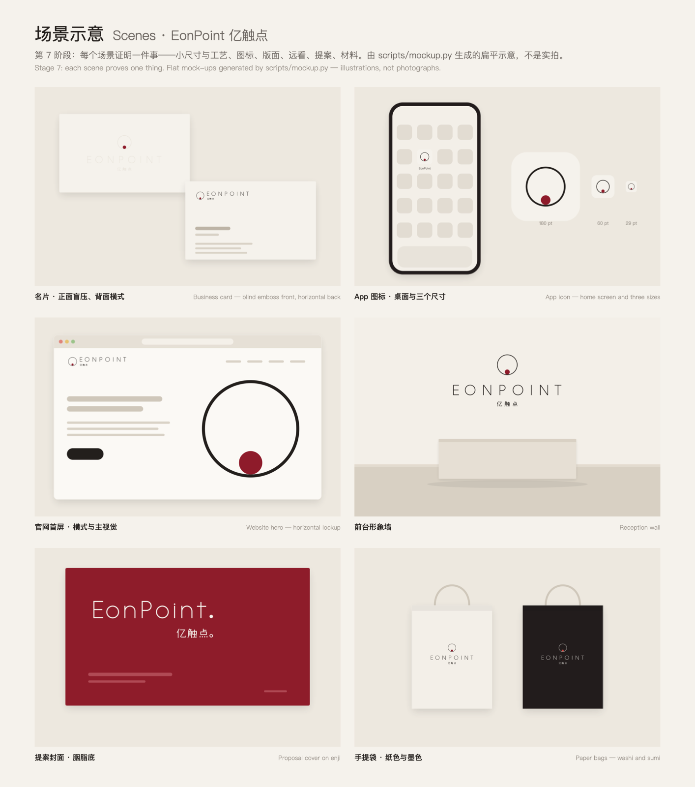
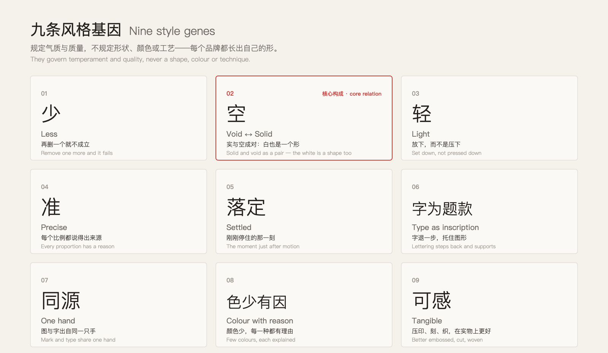
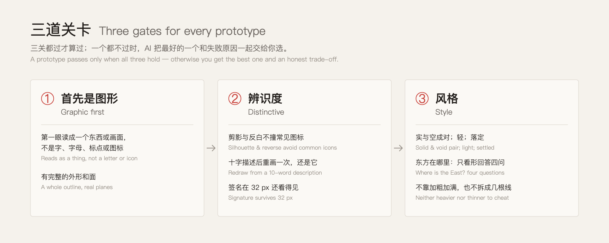

<div align="center">



**English** · [中文](README.zh-CN.md)


</div>

**DanLogo · East Minimal** is an [Agent Skill](https://agentskills.io) that lets AI tools such as Claude and Codex design **complete logo identity systems** in the East-Asian minimalist tradition: the mark, custom bilingual lettering, colour, the system, scenes, the proposal and the delivery files. It takes a brand from brief to delivery, one confirmed stage at a time, and holds every mark to one standard: **the fewest forms, the deepest meaning.**

> 用最少的形，承载最深的意思；留出空间，让人自己完成理解。

---

## Why this skill

An AI can draw a logo in seconds, and most of those logos look generated: generic geometry, a story pasted on afterwards, letters dressed up as symbols. This skill gives the agent a point of view and a way of working.

- **An Eastern way of thinking, not a look.** Its root is Laozi's idea that emptiness is what makes a thing useful. That idea reaches design through the Eastern arts — the few strokes of Bada Shanren's ink paintings, the dry gardens of Zen temples — and is informed by contemporary design thinking such as that of Kenya Hara, Dieter Rams and MUJI. It takes their thinking and leaves their surfaces alone.
- **Nine stages, and you sign off on every one.** Nothing gets locked without you, and `decisions.md` records each round, so a project can continue in another session or another AI.
- **Gates that catch the usual failures.** A mark must read as a graphic first, survive silhouette, reverse and 16 px, and still feel like the style.
- **Honesty built in.** When no prototype passes, the agent says so and hands you the trade-off instead of dressing up a weak option.

## How it works



Most of the craft lives in **stage 2** and **stage 3**:

- **Concepts.** The agent lists at least ten candidate motifs taken from facts about the brand: what its people do every day, what everyone sees but nobody notices, the meaning of the name. It turns five of them into concept cards, each with a black-and-white sketch and a self-check, and recommends one.
- **Prototypes.** Each concept you lock becomes at least three prototypes. A first drawing is usually just an illustration of the motif; the technique library turns it into a mark that belongs to this brand alone; East Minimal leans on precise relation, extreme contrast, cropping, reduction to planes, figure–ground reversal and one deliberate deviation.

Stages 4–9 turn the chosen mark into a finished identity, each with its own method:

| Stage | What the skill does |
|---|---|
| 4 Refine | One base number drives every proportion; curves and joins checked at 400%; optical corrections; a separate small-size version; construction drawing; strokes outlined |
| 5 Finalize | Chinese and English lettering drawn from scratch to match the mark; colour studied from concept, material and name; 2–3 paired type-and-colour options |
| 6 System | Rules first, files second: lockups, clear space and minimum sizes measured on renders, colourways, secondary graphics grown from the mark's relation, motion, misuse |
| 7 Scenes | Each scene proves one thing (small size, distance, craft, layout, state); flat mock-ups from `scripts/mockup.py`, honestly labelled |
| 8 Proposal | Tells the new understanding before the form; one idea per page, construction as evidence, a page on the roads not taken, speaker notes |
| Delivery | Outlined SVG and print PDF, icon sets and favicons, CMYK and spot-colour references, craft specs for printers, trademark artwork, VI manual, generator code |
| 9 Retrospective | Asks whether to fold the project back into the skill as a case or rule change |

## See it on a real project: EonPoint 亿触点

The skill was reverse-engineered from a real, client-approved bilingual identity for **EonPoint 亿触点**, an AI services company. Here is that project, stage by stage.



<sub>Stages 2–4 · four rounds. Red outlines mark the directions the client kept; the quotes are the client's own words. More layers made it look generated, tidying was not enough, and only re-seeing the point itself opened the right door.</sub>



<sub>The final idea, <b>one solid, one void</b>. The English full stop is the point that is touched; the Chinese full stop is the ring that holds a hundred million. Every proportion comes from one base number, and the construction drawing is the most persuasive page of the proposal.</sub>



<sub>Every prototype gets a review board from <code>scripts/review.py</code>: silhouette, reverse, 32 / 16 px, actual size, round avatar and ink ratio (here 14%). Judgements are made on rendered images, not on the story.</sub>





<sub>Stages 5–6 · custom bilingual lettering, colour, lockups, reverse, blind emboss, icons and motion, all generated from code. The mark doubles as a product state: the point circles while the AI is thinking and settles at the bottom when it is done.</sub>



<sub>Stage 7 · each scene proves one thing: the blind-embossed card proves craft at small size, the app icon proves 29 pt, the website proves layout, the wall proves distance, the cover proves colour, the bags prove material. Flat mock-ups from <code>scripts/mockup.py</code> — illustrations, not photographs.</sub>

Every decision in this project was traced back to a principle. The principles became the style chapters; the specifics stayed in [`cases/`](cases/), labelled **borrow the method, not the form**. New projects may not reuse its motif, its core relation or its form language.

## The style in nine genes



The core relation is **solid and void as a pair**: the white inside the mark is designed as carefully as the black, so removing either one breaks the meaning. The genes describe temperament, never a fixed shape, colour or technique, so every brand grows its own form. Projects even have to turn at least two "knobs" (form language, weight, warmth, colour, composition and so on) away from every past case.

## Three gates for every prototype



## Install

**Claude Code**

```bash
git clone https://github.com/dan-cube/danlogo-eastminimal.git
cd danlogo-eastminimal
./install.sh claude        # installs to ~/.claude/skills/danlogo-eastminimal
```

**Codex**

```bash
./install.sh codex         # installs to ~/.agents/skills/danlogo-eastminimal, then restart Codex
```

**claude.ai or the Claude desktop app.** Download `danlogo-eastminimal.skill` from [Releases](../../releases) and upload it in the Skills section of your Claude settings. To build the package yourself, run `./install.sh package`.

**Requirements.** The tools use only the Python 3 standard library. On macOS, PNG rendering works out of the box through Quick Look. On other systems, install `librsvg` (`rsvg-convert`) or run `pip install cairosvg`.

To update, run `git pull && ./install.sh`.

## Quick start

Just describe the brand. For example:

```text
Design a logo in the East Minimal style for "North Window", a small
architecture studio that designs homes and libraries. Calm, precise,
warm. No houses with pitched roofs, no blueprints, no pencils.
```

```text
用东方极简的风格，给『北窗建筑工作室』做一个 logo：做住宅和图书馆的小型建筑事务所，
想要安静、准确、温暖；不要尖顶房子、蓝图和铅笔。
```

In Codex you can call it explicitly with `$danlogo-eastminimal`. To pick up an earlier project, point the agent at the project folder; it reads `decisions.md` and continues from the last decision.

**What to expect**

1. The agent asks up to ten questions, all at once, and writes a one-page brief card. Anything you skip becomes a clearly marked assumption.
2. It shows five concepts, each with a sketch and a one-line risk, and recommends one. You lock one to three.
3. It shows at least three prototypes per locked concept, with a review board, a preliminary similarity check and an honest verdict.
4. You then refine together, finalize the custom lettering and colour, and build the system, scenes and proposal.

## Getting the best out of it

- **Give real facts, not adjectives.** What your people do every day is where the strongest motifs come from.
- **Say what you don't want.** Every "no" is a clue.
- **Lock few concepts.** One to three; every locked concept costs at least three prototypes per round.
- **Judge the pictures.** Look at the review board at 16 px before you fall for a story.
- **Stage 4 is yours.** Proportion, the size of the signature detail and the character of the outline need a designer's eye. The skill keeps the process, the ideas and the floor; the final finesse is made together.

## What it is not

- **Not a one-click generator.** It is a design partner with a method. It won't call a mark finished without you.
- **Not a trademark search.** Similarity checks are preliminary web searches. Use a trademark attorney before you register anything.
- **Not a vector illustrator.** Marks are drawn as parametric code (SVG). Expect a final pass in your design tool for refined curves and outlined strokes.
- **Not affiliated** with any artist, designer, brand or work cited. They are references for thinking only.

## What's inside

```text
SKILL.md                     entry point: positioning, three layers, nine stages
references/
  philosophy.md              style 1 · Eastern coordinates and ten design ideas
  exemplars.md               style 1 appendix · reference works, and how to learn from them without copying
  style-dna.md               style 2 · core relation, nine genes, knobs, touchstones
  creative-methods.md        style 3 · motif questions, seven methods, concept card
  workflow.md                shared · the nine stages in detail
  quality-gates.md           shared · graphic-first, distinctiveness, AI-flavour, similarity checks
  craft.md                   shared · from illustration to mark, construction, lettering, colour
  deliverables.md            shared · system, scenes, proposal, post-production, delivery
  feedback-playbook.md       shared · feedback → diagnosis → action
cases/                       EonPoint 亿触点 · the project this style was distilled from
examples/                    that project's full generator code (learn the method, never the form)
scripts/                     geom.py · sheet.py · render.sh · review.py · mockup.py
adapters/                    differences between Claude and Codex
evals/                       test briefs and run records
install.sh                   install · update · package
```

## The danlogo series

DanLogo · East Minimal is the first skill in the **danlogo** series. Every danlogo skill shares the same workflow and quality gates (`danlogo-core`) and differs only in three style chapters: its philosophy, its style DNA and its creative methods. The rules for building a new style live in the series standard (`standard/` in danlogo-maker).

## Updating and contributing

- When a project finishes (stage 9), the agent asks whether to fold it back into the skill as a new case or as rule changes. Nothing is written without your approval.
- The shared chapters are maintained in the series standard and synced to every style.
- Issues and ideas are welcome.

## License

The skill's text and code are released under the [MIT License](LICENSE): you may use, copy, modify and redistribute them, including commercially, as long as the copyright notice and licence text travel with them.

The EonPoint 亿触点 name, marks and case images belong to their owner. They are included as a case study only and are **not** covered by the MIT License; please don't reuse them.
