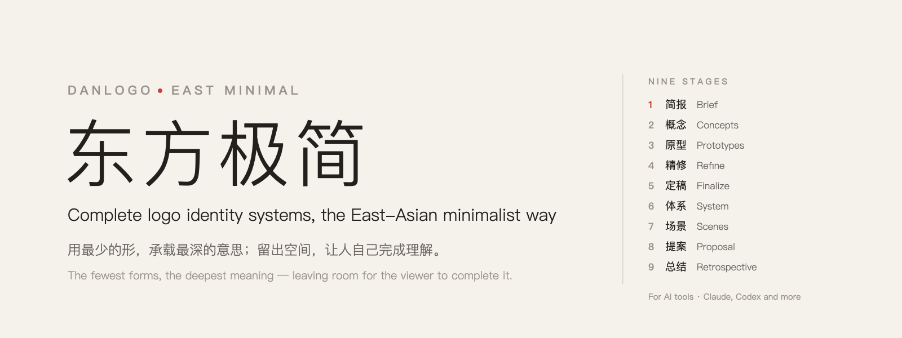
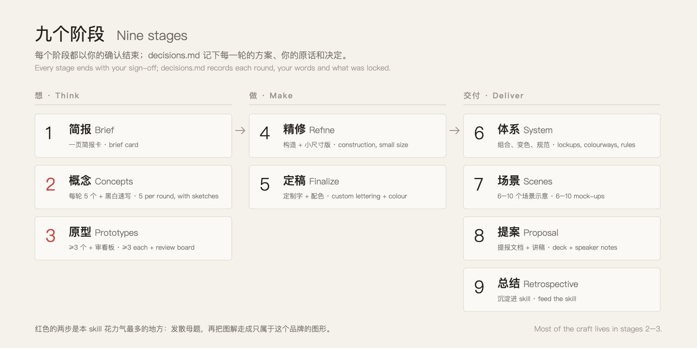
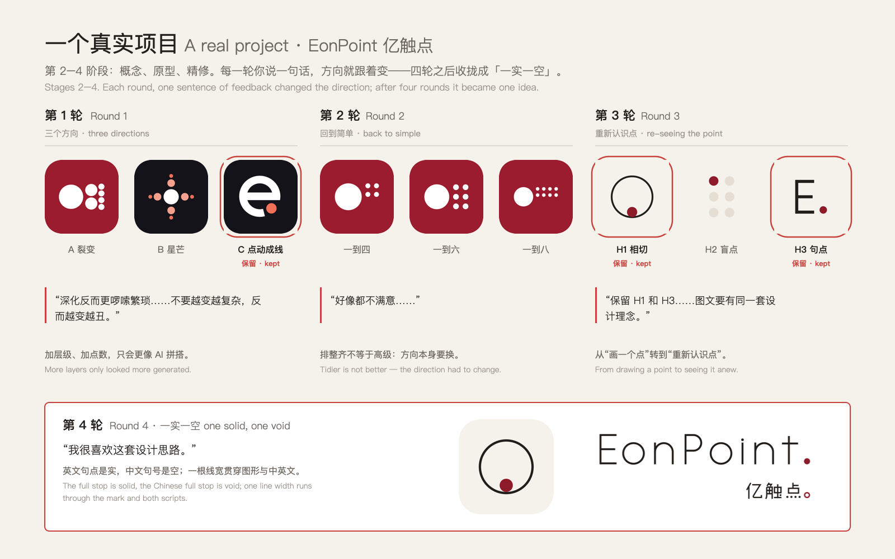
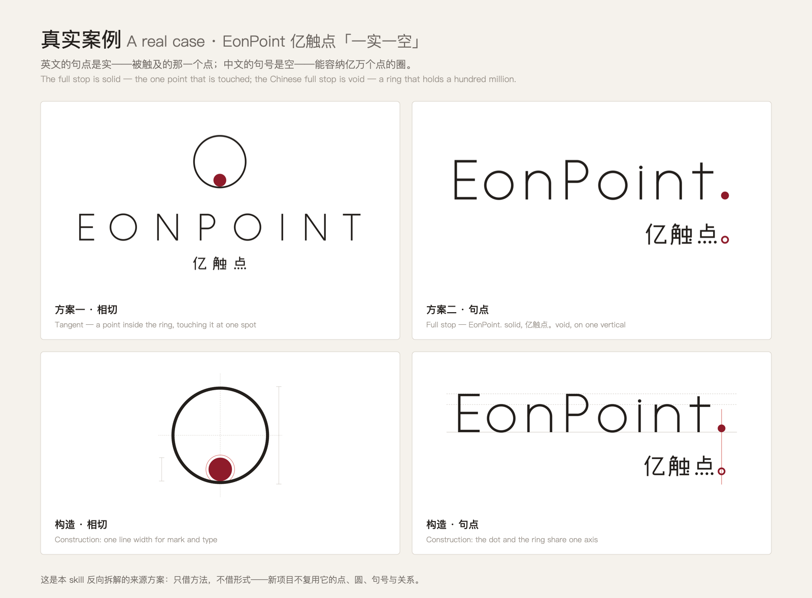
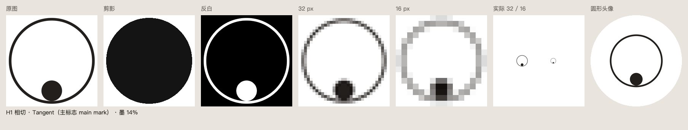
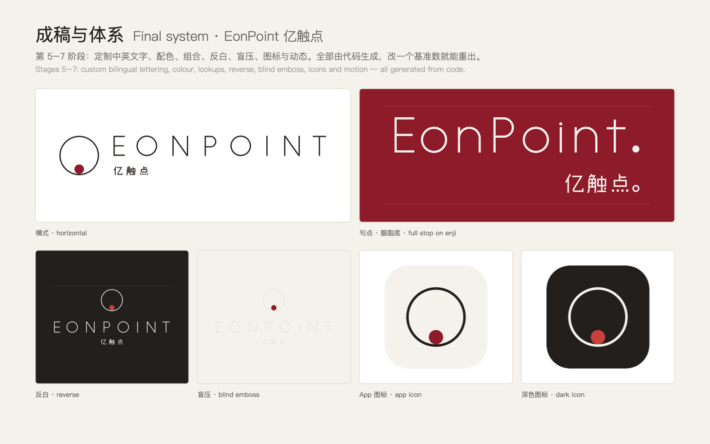
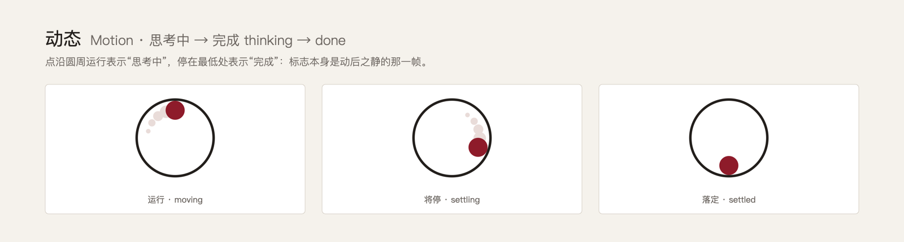
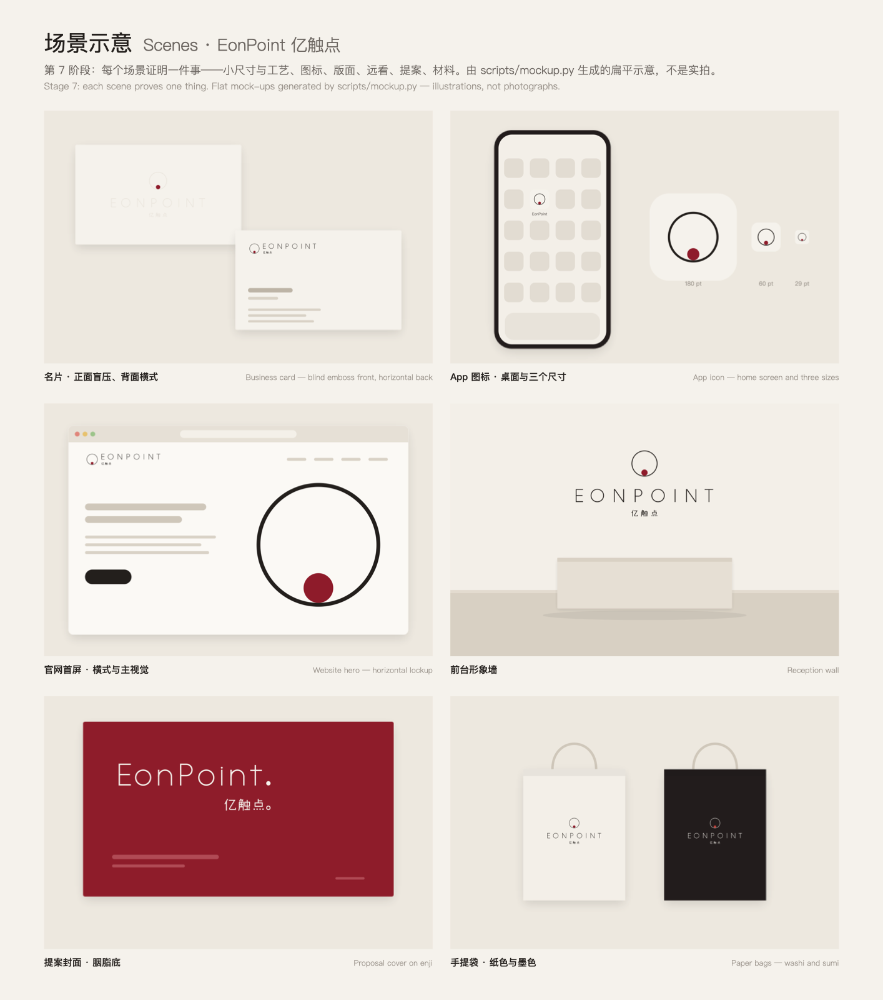
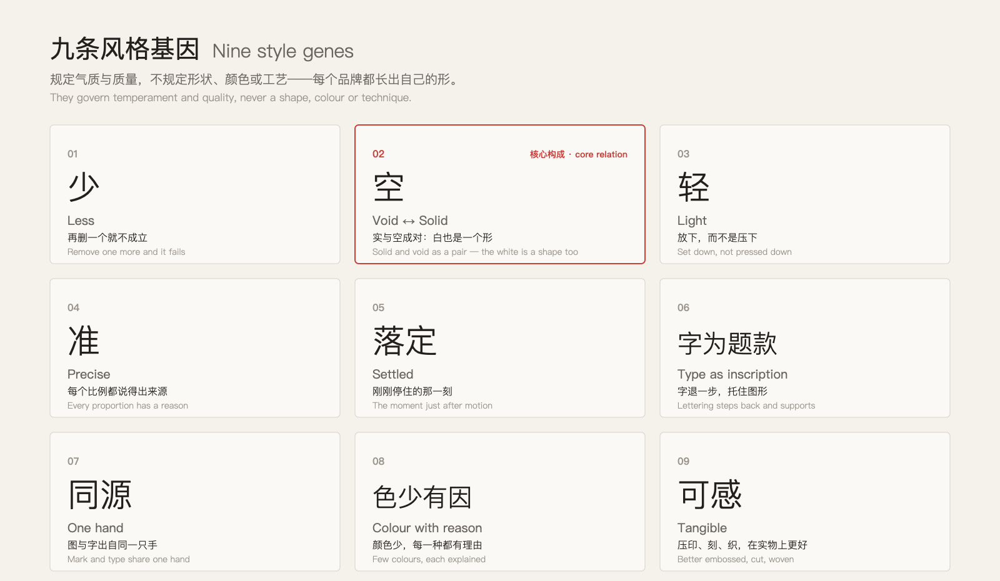
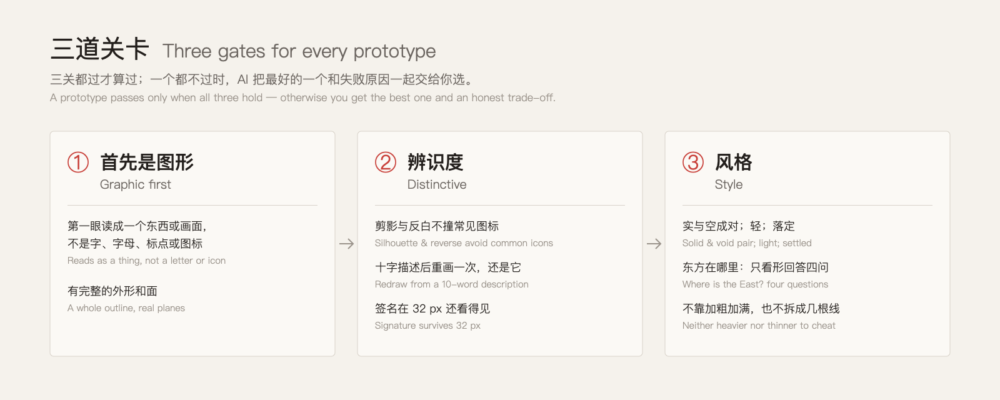

<div align="center">



[English](README.md) · **中文**


</div>

**DanLogo · East Minimal 东方极简**是一个 [Agent Skill](https://agentskills.io)。它让 AI 工具（如 Claude、Codex 等）按东方极简的思路，做**成套的 logo 体系**：图形、中英文定制字、配色、规范体系、场景、提案和交付文件。从简报到交付，一步一确认；每一个标志都要做到——

> 用最少的形，承载最深的意思；留出空间，让人自己完成理解。

---

## 为什么需要它

AI 几秒钟就能画出一个 logo，但大多数一看就是“生成的”：通用的几何拼装，先有形再编故事，把字母当符号。这个 skill 给 AI 一种眼光和一套做法：

- **一种东方的思想，而不是一种样子。** 以老子“无之用”的东方思想为根——起作用的往往是空的那一部分；经由东方的艺术传统转化为设计方法：八大山人的笔简意足、枯山水的以少见多；再参照原研哉、Dieter Rams、无印良品等当代艺术设计理念。只学思想，不学表面。
- **九个阶段，每一步都由你确认。** 不经你同意，什么都不锁定。`decisions.md` 记下每一轮，换会话、换 AI 都能接着做。
- **关卡专拦常见的失败。** 标志首先要是一个图形；剪影、反白、16 px 都要站得住；还要保住风格。
- **诚实写在规则里。** 一个原型都没过时，AI 会直说，把取舍交给你，而不是把弱的说成好的。

## 怎么工作



最花力气的是第 2、3 两步：

- **概念**：先从品牌本身列出至少 10 个候选母题——这家公司每天在做什么、行业里什么东西人人见过却没人注意、名字的意思是什么。再挑出 5 个写成概念卡，每张配一张黑白速写和自查，并推荐其中一个。
- **原型**：你锁定的每个概念，至少出 3 个原型。第一次画出来的往往只是母题的图解；要用六种转译手法把它变成只属于这个品牌的图形：精确的关系、极端的对比、截取、化为几何面、图底反转、一处偏差。

第 4–9 阶段把选定的图形做成完整的体系，每一步都有自己的方法：

| 阶段 | skill 怎么做 |
|---|---|
| 4 精修 | 一个基准数推出所有比例；400% 检查曲线与交接；视觉修正；单独的小尺寸版；构造图；描边转路径 |
| 5 定稿 | 中英文字从零绘制、与图形同源；颜色从概念、材料、名字里来；成对给出 2–3 套“字 + 色” |
| 6 体系 | 先定规则再出文件：组合、实测的留白与最小尺寸、色彩版本、从母题关系延展的辅助图形、动态、错误用法 |
| 7 场景 | 每个场景证明一件事（小尺寸、远看、工艺、版面、状态）；用 `scripts/mockup.py` 做扁平示意，诚实标注 |
| 8 提案 | 先讲认识再讲形；一页一个想法，构造图作证据，讲被否的方向，附演讲备注 |
| 交付 | 转路径的 SVG 与印刷 PDF、各平台图标与 favicon、CMYK 与专色参考、给供应商的工艺参数、商标注册用稿、VI 手册、生成代码 |
| 9 总结 | 询问是否把这个项目沉淀进 skill：新增案例或调整规则 |

## 看一个真实项目：EonPoint 亿触点

这个 skill 是从一个真实、已经客户确认的双语品牌方案反向拆解出来的：**EonPoint 亿触点**，一家 AI 企业服务公司。下面按阶段看这个项目。



<sub>第 2–4 阶段，四轮。红框是客户保留的方向，引号里是客户的原话。加层级只会更像 AI 拼搭，排整齐也不够，直到换成“重新认识点”的思路，才找对了门。</sub>



<sub>定稿的想法是<b>一实一空</b>：英文的句点是被触及的那一个点，中文的句号是能容纳亿万个点的圈。每个比例都从一个基准数推出，构造图本身就是提案里最有说服力的一页。</sub>



<sub>每个原型都要出一张审看板（<code>scripts/review.py</code>）：剪影、反白、32 / 16 px、实际大小、圆形头像和墨色比例（这里是 14%）。好不好看，只看渲染出来的图，不听故事。</sub>





<sub>第 5–6 阶段：定制中英文字、配色、组合、反白、盲压、图标与动态，全部由代码生成。标志同时是产品里的状态：点沿圆周运行表示“思考中”，停在最低处表示“完成”。</sub>



<sub>第 7 阶段：每个场景证明一件事——盲压名片证明小尺寸与工艺，App 图标证明 29 pt，官网证明版面，形象墙证明远看，提案封面证明色底，手提袋证明材料。由 <code>scripts/mockup.py</code> 生成的扁平示意，不是实拍。</sub>

方案里的每一个决定都追问到原则层：原则写成了风格三章，具体做法留在 [`cases/`](cases/) 里，标明**只借方法，不借形式**。新项目不能复用它的母题、核心关系和造型语言。

## 九条风格基因



核心构成关系是**实与空成对**：标志里的白和黑一样被设计，拿掉哪一个，意思都不成立。基因只规定气质，不规定形状、颜色或工艺，所以每个品牌都会长出自己的形；每个项目还必须在造型语言、力度、温度、色彩、构图等“旋钮”上，至少有两个与过去的案例明显不同。

## 每个原型都要过三道关



## 安装

**Claude Code**

```bash
git clone https://github.com/dan-cube/danlogo-eastminimal.git
cd danlogo-eastminimal
./install.sh claude        # 装到 ~/.claude/skills/danlogo-eastminimal
```

**Codex**

```bash
./install.sh codex         # 装到 ~/.agents/skills/danlogo-eastminimal，然后重启 Codex
```

**claude.ai 或 Claude 桌面版**：从 [Releases](../../releases) 下载 `danlogo-eastminimal.skill`，在 Claude 设置的技能（Skills）里上传。也可以自己运行 `./install.sh package` 打包。

**环境要求**：工具只用 Python 3 标准库。macOS 上通过系统的 Quick Look 渲染 PNG，开箱即用；其他系统请安装 `librsvg`（`rsvg-convert`），或 `pip install cairosvg`。

**更新**：`git pull && ./install.sh`。

## 快速开始

直接说需求，例如：

```text
用东方极简的风格，给『北窗建筑工作室』做一个 logo：做住宅和图书馆的小型建筑事务所，
想要安静、准确、温暖；不要尖顶房子、蓝图和铅笔。
```

```text
Design a logo in the East Minimal style for "North Window", a small
architecture studio that designs homes and libraries. Calm, precise,
warm. No houses with pitched roofs, no blueprints, no pencils.
```

在 Codex 里可以用 `$danlogo-eastminimal` 显式调用。要接着做以前的项目，把项目文件夹告诉 AI：它会先读 `decisions.md`，再从最后一个决定继续。

**接下来会发生什么**

1. AI 一次性问完缺的信息（最多 10 个问题），写成一页简报卡；没回答的写成假设并标出来。
2. 给出 5 个概念，每个配速写和一行风险，推荐 1 个；你锁定 1–3 个。
3. 每个锁定的概念至少出 3 个原型，附审看板、初步查重和诚实的评价。
4. 之后和你一起精修，定制中英文字、做配色，再做体系、场景和提案。

## 怎样用得更好

- **给事实，不要只给形容词。** 你们每天在做什么，最好的母题往往就藏在那里。
- **说清楚不要什么。** 每一个“不要”都是线索。
- **少锁几个概念。** 1–3 个就好，每锁一个，每轮就多至少 3 个原型。
- **看图，不听故事。** 先在审看板上看 16 px，再决定喜不喜欢。
- **第 4 阶段交给你的眼睛。** 黑白比例、签名细节的大小、外形的个性，需要设计师的判断。skill 守住流程、想法和底线，最后的分寸一起打磨。

## 它不是什么

- **不是一键生成器。** 它是一个有方法的设计伙伴，不会在你没点头时宣布定稿。
- **不是商标检索。** 查重只是初步的网络检索；注册前请找商标代理做正式检索。
- **不是矢量插画工具。** 图形用参数化代码画成 SVG；精细的曲线和描边转路径，建议最后在设计软件里过一遍。
- **与文中提到的任何艺术家、设计师、品牌或作品都没有关联。** 它们只是思想上的参照。

## 仓库里有什么

```text
SKILL.md                     入口：定位、三层要求、九个阶段
references/
  philosophy.md              风格章 1：东方思想坐标与十条设计思想
  exemplars.md               风格章 1 附录：参照作品，以及怎么看示范才不会照抄
  style-dna.md               风格章 2：核心构成、九条基因、旋钮、试金石
  creative-methods.md        风格章 3：母题五问、七种方法、概念卡
  workflow.md                共用：九阶段细则
  quality-gates.md           共用：首先是图形、辨识度、AI 味、查重
  craft.md                   共用：从图解到图形、构造、定制字、配色
  deliverables.md            共用：体系、场景、提案、后期制作与交付
  feedback-playbook.md       共用：反馈 → 诊断 → 动作
cases/                       EonPoint 亿触点：本风格的来源方案及其反向拆解
examples/                    该方案的完整生成代码（学方法，不复用造型）
scripts/                     geom.py · sheet.py · render.sh · review.py · mockup.py
adapters/                    Claude 与 Codex 的差异
evals/                       测试简报与试跑记录
install.sh                   安装、更新、打包
```

## danlogo 系列

东方极简是 **danlogo** 系列的第一个 skill。系列里的每个 skill 共用同一套流程和质量关卡（`danlogo-core`），只换三章风格：思想坐标、风格基因、创意方法。制作新风格的规则在 **danlogo-standard** 里。

## 更新与贡献

- 每个项目结束时（第 9 阶段），AI 会问你是否把这个项目沉淀进 skill：新增案例，或调整规则。没有你的批准，什么都不写。
- 共用章节在 `danlogo-standard` 里统一维护，再同步到各个风格。
- 欢迎提 Issue 和想法。

## 许可

公开发布时确定。
